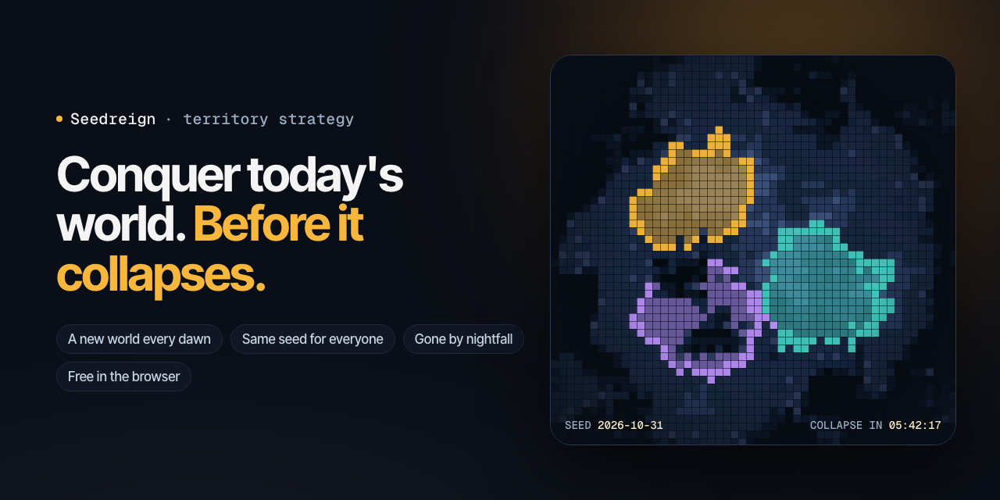

# Seedreign



Territory conquest `.io` strategy game. One procedurally generated world is sown
every dawn, the same seed for everyone, and it collapses at nightfall.

**Status: early development.** This repository holds the website: the landing
page, profile and sign-in, with the game canvas to follow on the same domain.
The game itself is not playable yet.

The full game design (lore, mechanics, economy and technical decisions) is in
[`CLAUDE.md`](./CLAUDE.md). Read it before changing anything.

## Getting started

```bash
bun install
bun run dev
```

Open <http://localhost:3000>.

## Scripts

| Script              | What it does                                          |
| ------------------- | ----------------------------------------------------- |
| `bun run dev`       | Dev server (Turbopack)                                |
| `bun run build`     | Production build                                      |
| `bun run start`     | Serve the production build                            |
| `bun run check`     | Format, sort Tailwind classes, organize imports, lint |
| `bun run lint`      | Lint only                                             |
| `bun run format`    | Format only                                           |
| `bun run ci`        | Verify everything without writing (use in CI)         |
| `bun run typecheck` | Route typegen plus `tsc --noEmit`                     |

**bun only.** No npm, pnpm or yarn. **Biome only.** No ESLint or Prettier.

## Internationalisation

English first, Portuguese second.

- Default locale `en` is served **without a prefix**: `/`
- Portuguese is served at `/pt`
- `messages/en.json` is the **source of truth**, `messages/pt.json` is a
  translation.
- **No hardcoded UI strings.** Every user visible string comes from a
  translation key.

### Adding a language

1. Copy `messages/en.json` to `messages/xx.json` and translate the values.
2. Add `"xx"` to `locales` in `src/i18n/routing.ts`.

That is the whole change, and **no existing file needs editing**. Routing, the
proxy, `generateStaticParams`, the hreflang metadata, the sitemap and the
language switcher all read from `routing.locales`, and the switcher gets each
language's own name from `Intl.DisplayNames` rather than a hand maintained key.

> The one line in `routing.ts` is not avoidable: `defineRouting` needs a literal
> tuple for the locale types, and `generateStaticParams` needs the list at build
> time. Deriving it from the filesystem would cost type safety and prerendering.

## SEO

Everything is generated from `src/lib/site.ts` and the locale list:

- `robots.txt`, `sitemap.xml` with per locale hreflang alternates, and a web
  app manifest
- canonical plus hreflang links, Open Graph and Twitter cards per locale
- a generated Open Graph image per locale, an SVG favicon and an Apple touch
  icon
- `VideoGame` JSON-LD on the home page
- `public/llms.txt` describing the project for language models

## Stack

Next.js 16 (App Router) · TypeScript · Tailwind CSS v4 · shadcn/ui · next-intl ·
Motion · GSAP with ScrollTrigger · Lenis · Lucide · Biome · bun

## Layout

```
messages/                  translation catalogues, one file per locale
src/app/                   robots, sitemap, manifest, icons
src/app/[locale]/          locale scoped routes
src/components/ui/         design system primitives
src/components/sections/   page sections
src/components/layout/     shell: header, providers, HUD
src/hooks/                 shared hooks
src/i18n/                  routing, request config, navigation helpers
src/lib/                   site config and shared utilities
src/styles/                global stylesheet and design tokens
```

## License

[MIT](LICENSE)
